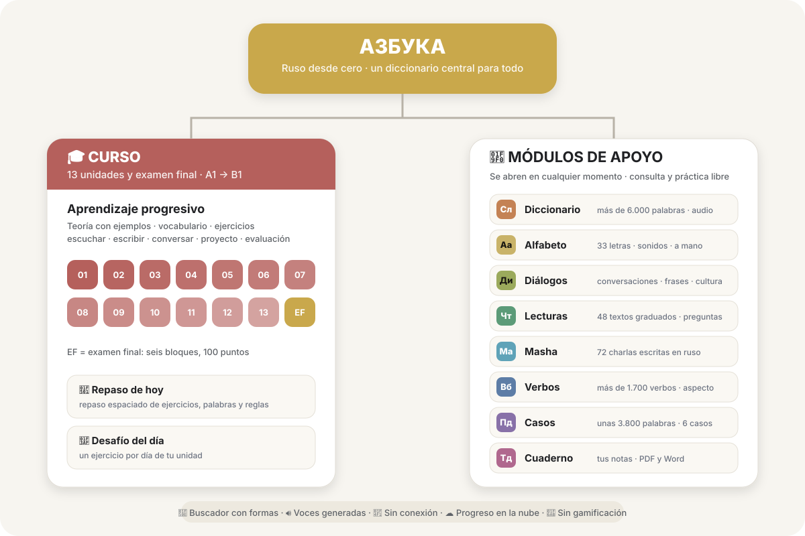

<div align="center">

# Азбука

### Ruso desde cero

[🇬🇧 English](README.md) · [🇪🇸 Español](README.es.md)

**Un curso web gratuito para hispanohablantes que quieren aprender ruso desde cero hasta el nivel B1.**

[**▶ Abrir Azbuka**](https://manum876.github.io/Azbuka_v3/) · [**Repositorio**](https://github.com/manum876/Azbuka_v3)

</div>

---

## Sobre el proyecto

**Азбука (Azbuka)** es un proyecto personal para que los hispanohablantes aprendan ruso desde cero hasta, aproximadamente, un **nivel B1**.

Combina un **curso de 13 unidades y un examen final** con **módulos de apoyo** que se abren en cualquier momento: diccionario, alfabeto, diálogos, lecturas, charla con Masha, verbos, casos y cuaderno. Todo el vocabulario vive en un **diccionario central** que conecta el curso y los módulos: cada palabra se escribe una sola vez y cada pantalla la muestra a su manera.

No hay **rachas, XP, vidas ni rankings**. El progreso es real: lo que ya sabes, lo que estás aprendiendo y lo que conviene repasar hoy.

> **Aprende en orden. Consulta lo que necesites. Practica lo que quieras.**

---

## Cómo está organizado



- **Curso:** 13 unidades progresivas, de A1 a B1, y un examen final.
- **Módulos de apoyo:** consulta y práctica libre, sin seguir el orden del curso.
- **Diccionario central:** la base que comparten todos.
- **Repaso de hoy:** una sesión diaria corta con lo que estás por olvidar.

---

## El curso

| Unidad | Tema principal |
|---|---|
| **01** | Alfabeto y pronunciación |
| **02** | Presentaciones y conversaciones básicas |
| **03** | Sustantivos, género y números |
| **04** | Casos I: nominativo y acusativo |
| **05** | Verbos en presente y acciones cotidianas |
| **06** | Ubicación, movimiento y caso prepositivo |
| **07** | Tiempo, fechas y rutina diaria |
| **08** | Pasado y experiencias personales (con el aspecto verbal) |
| **09** | Futuro y planes |
| **10** | Casos II: genitivo, dativo e instrumental |
| **11** | Comunicación cotidiana y ruso del mundo real |
| **12** | Gramática B1: pronombres, plural, aspecto, imperativo y comparar |
| **13** | Consolidación B1 y comunicación |
| **14** | Examen final: seis bloques, 100 puntos |

Cada unidad tiene:

- **teoría con ejemplos explicados**, frases desarmadas palabra por palabra, errores típicos, chequeos rápidos y «Más a fondo»;
- **vocabulario por grupos**, con listas y tarjetas: unas 2.000 palabras al final del curso;
- **un banco de ejercicios** que se adapta a cómo te va: escribir, traducir, escuchar, ordenar, completar, conversar, y tipos que practican la regla («¿por qué?», «¿suena natural?», «¿qué falla?»…). Si algo sale mal, «📖 Repasar la regla» abre la explicación;
- **diálogos para grabarte**, un proyecto de escritura y una evaluación.

El enfoque es **orientado a la producción**: no alcanza con reconocer la respuesta, hay que escribirla. La corrección es tolerante (acentos, е/ё y mayúsculas no cuentan) y explica cada error. Desde la Unidad 11, las situaciones abiertas se corrigen por intención: «✓ Bien», «💬 Se entiende» o «✗ No se entiende».

---

## Módulos de apoyo

### 📚 Diccionario

La base de toda la app: **más de 6.000 palabras** (Comer 5000 más vocabulario propio). Cada una tiene:

- la palabra con su **acento marcado**;
- la **IPA** y una **pronunciación figurada en español** (jarashó, spasíba);
- categoría gramatical y tema (comida, casa, viajes…);
- una o varias **acepciones**, con traducción y definición en español;
- género, animacidad y número en los sustantivos; aspecto y pareja aspectual en los verbos;
- audio, notas culturales y «Tu progreso» (no estudiada, aprendiendo, dominada).

Se explora por tema y por categoría, o con el buscador.

### 🔤 Alfabeto

Las **33 letras** del alfabeto cirílico: imprenta y cursiva, pronunciación explicada en español, errores comunes, palabras de ejemplo con audio, seguimiento de las letras dominadas y **escritura a mano** con el dedo, calcando o libre.

### 💬 Diálogos

Conversaciones de situaciones cotidianas (también en versión con **вы**), con traducción, transliteración, «palabra por palabra» y modo práctica. Además, **frases útiles** que se aprenden enteras y **notas culturales**.

### 📖 Lecturas

**48 textos graduados**, cuatro por unidad de la U2 a la U13, de unas 40 palabras al principio a unas 250 al final. Cada uno tiene audio, traducción a pedido y preguntas de comprensión. Una palabra que no conoces se selecciona y se abre su entrada.

### 🙂 Hablar con Masha

Una **charla escrita en ruso con Masha**, la estudiante moscovita que acompaña el curso: **72 temas**, seis por unidad, con el vocabulario y la gramática de cada nivel. Masha recuerda lo que le contaste, contesta preguntas sobre su vida, sugiere ideas cuando no sabes qué decir y te propone «💬 Mejor» una versión más correcta de lo que escribiste. No es una IA: la charla está escrita de antemano y se ramifica según lo que contestas.

### 🗣️ Verbos

Las conjugaciones de **más de 1.700 verbos**:

- presente, futuro, pasado e imperativo, con audio en cada forma;
- la **pareja aspectual** al lado (imperfectivo / perfectivo), con el tipo de pareja cuando no es pura («un rato», «empezar a», «ir y volver»);
- **rección**: qué caso pide cada verbo, con explicación y ejemplos.

### 📐 Casos

Las declinaciones de **unas 3.800 palabras**: sustantivos, adjetivos, pronombres, determinantes y numerales.

- Los **6 casos** en singular y plural, o por género en los adjetivos, con audio.
- Formas especiales: locativo (в лесу́), partitivo (ча́ю), forma de conteo (два часа́), forma corta y comparativo.
- La guía **«Cómo funcionan los casos»**, con las preguntas de cada caso, la rección y práctica.

### 📝 Cuaderno

Tus notas, ordenadas por secciones. Se guarda cualquier texto seleccionado en la app, una palabra, una frase o un error del corrector, y se exporta a **PDF** o **Word**.

---

## Repaso de hoy

Una sesión diaria de unos 10 minutos con **repaso espaciado** (cajas de 1, 3, 7 y 14 días) sobre ejercicios, palabras y reglas: lo que estás por olvidar, de cualquier unidad, más ejercicios de la unidad actual y «la regla del día». Aparte, el inicio propone un **desafío del día** según la unidad en la que estás.

---

## Voces

Todo el ruso de la app suena con **voces neuronales generadas de antemano** ([Silero](https://github.com/snakers4/silero-models), modelo v5_5_ru), con una voz para cada personaje (Masha, Olga Petrovna, Lucas, Dima…). Los audios viven en un repositorio aparte, [`Azbuka_voces`](https://github.com/manum876/Azbuka_voces), y el teléfono los guarda a medida que suenan. Si falta un audio, se usa la voz del teléfono.

---

## Filosofía

**1. Un camino claro.** El curso ofrece una progresión ordenada desde cero hasta B1, y cada unidad recicla lo anterior.

**2. Libertad de uso.** Los módulos se abren en cualquier momento, sin seguir el orden del curso.

**3. Una referencia confiable.** Para recordar cómo se dice algo, conjugar un verbo o entender un caso, Azbuka tiene que alcanzar por sí sola. Por eso las formas no se inventan: salen de fuentes cruzadas y revisadas a mano.

**4. Pensar en ruso.** Las explicaciones usan el español solo cuando ayuda a entender una idea, nunca como modelo para traducir.

---

## Características

- 🎓 Curso de 13 unidades y examen final, A1 → B1
- 📚 Diccionario central de más de 6.000 palabras, con acento, IPA y pronunciación figurada
- 🗣️ Más de 1.700 verbos conjugados, con pareja aspectual y rección
- 📐 Unas 3.800 palabras declinadas en los 6 casos
- 📖 48 lecturas graduadas y 🙂 72 charlas con Masha
- 🔁 Repaso espaciado y sesión diaria
- 🔎 Buscador en ruso y en español, que reconoce formas declinadas y conjugadas
- 🔊 Voces generadas para todo el ruso de la app
- 📱 Pensada primero para el iPhone; se instala en la pantalla de inicio y funciona sin conexión
- ☁️ Cuenta con código por mail y progreso guardado en la nube
- 🌓 Tema claro y oscuro
- 🚫 Sin gamificación y sin funciones de IA: la corrección es por reglas

---

## Tecnología

- HTML, CSS y JavaScript, **sin proceso de build**.
- [Preact](https://preactjs.com/) + [htm](https://github.com/developit/htm), incluidos en el repositorio (`assets/preact.js`).
- **Service worker** para usarla sin conexión; `localStorage` para el progreso en el teléfono.
- **Cuentas:** [Supabase](https://supabase.com/) (acceso por invitación y progreso en la nube) y Brevo para el mail con el código.
- **Voces:** Silero, generadas con GitHub Actions en el repositorio `Azbuka_voces`.
- **Cuaderno:** jsPDF y fflate, para exportar a PDF y Word en el propio teléfono.
- Publicada con **GitHub Pages**.

---

## Fuentes de los datos

- **Vocabulario:** Comer, K. *Comer 5000* (Portland State University) y los diccionarios ruso–español de [FreeDict](https://freedict.org/) (CC BY-SA 3.0).
- **Conjugaciones y declinaciones:** datos de [OpenRussian.org](https://github.com/Badestrand/russian-dictionary) (CC BY-SA 4.0).
- **Controles:** contrastadas con el analizador morfológico pymorphy3 (diccionario OpenCorpora) y con los índices de acentuación del Diccionario gramatical de Zalizniak.
- **Mapa:** [Natural Earth](https://www.naturalearthdata.com/) (dominio público).
- **Contenido propio:** definiciones, explicaciones, ejercicios, diálogos, lecturas, la charla con Masha y notas, redactados para Azbuka.

---

## Ejecutar localmente

```bash
git clone https://github.com/manum876/Azbuka_v3.git
cd Azbuka_v3
python3 -m http.server
```

Después abre `http://localhost:8000` en el navegador. Hace falta un servidor local porque las páginas cargan archivos de datos.

---

## Estructura del repositorio

```text
Azbuka_v3/
├── index.html            ← inicio
├── azbuka-index-1.html   ← índice del curso A1 → B1
├── azbuka-1.html …       ← unidades (azbuka-14.html: examen final)
├── ficha.html            ← diccionario y ficha de palabra
├── alfabeto.html, dialogos.html, lecturas.html, masha.html,
│   verbos.html, casos.html, cuaderno.html   ← módulos de apoyo
├── repaso.html           ← repaso de hoy
├── ajustes.html
├── manifest.webmanifest  ← datos de la app instalada
├── sw.js                 ← funcionamiento sin conexión
├── js/                   ← código compartido (catálogo, menú, progreso, corrector, unidades, cuentas…)
├── data/                 ← datos
│   ├── data-lexicon.js   ← diccionario central
│   ├── data-verbos.js    ← conjugaciones
│   ├── data-casos.js     ← declinaciones
│   └── …                 ← gramática, alfabeto, diálogos, lecturas, Masha, unidades
├── assets/               ← estilos, fuentes, íconos y librerías
├── herramientas/         ← lo que no usa la app: generador de IPA, guion de Masha,
│                            voces, cuentas y verificadores automáticos
├── README.md, README.es.md
└── LICENSE, LICENSE-CONTENT
```

---

## Estado del proyecto

✅ **El curso A1 → B1 está completo:** las 13 unidades, el examen final y todos los módulos de apoyo.

Lo que sigue: diálogos de nivel A2 y B1, familias de palabras y, más adelante, los niveles B1 → B2 y B2 → C1.

---

## Contribuciones

Azbuka es un proyecto personal de **Juan Manuel Muñoz**. El repositorio está abierto para explorarlo y aprender de él según sus licencias, pero no acepta cambios directos de terceros. Si encuentras un error o tienes una sugerencia, abre un issue.

---

## Licencia

Azbuka usa **dos licencias**, porque el software y el contenido educativo tienen objetivos distintos.

- **Código:** Licencia MIT. Ver [`LICENSE`](LICENSE).
- **Contenido educativo** (curso, ejercicios, definiciones, explicaciones, diálogos, lecturas, la charla con Masha): **CC BY-NC-ND 4.0**. Ver [`LICENSE-CONTENT`](LICENSE-CONTENT).
- **Excepción:** las tablas de conjugación (`data/data-verbos.js`) y de declinación (`data/data-casos.js`) derivan de datos de OpenRussian.org y se distribuyen bajo **CC BY-SA 4.0**, como pide su licencia original.

**Componentes de terceros**, cada uno con su licencia:

| Componente | Licencia |
|---|---|
| Preact y htm (`assets/preact.js`) | MIT y Apache 2.0 (`assets/preact-LICENSE.txt`) |
| supabase-js (`assets/supabase.js`) | MIT (`assets/supabase-LICENSE.txt`) |
| jsPDF y fflate | MIT (`assets/jspdf-LICENSE.txt`, `assets/fflate-LICENSE.txt`) |
| Fuentes Noto Sans y Marck Script | SIL Open Font License (`assets/*-OFL.txt`) |
| Mapa de Natural Earth | Dominio público |
| Voces de Silero (repositorio `Azbuka_voces`) | CC BY-NC 4.0: solo uso no comercial |

---

## Autor

**Juan Manuel Muñoz**

Un proyecto personal e independiente para que aprender ruso desde el español sea más ordenado, accesible y práctico.

<div align="center">

[▶ Probar Azbuka](https://manum876.github.io/Azbuka_v3/)

</div>
