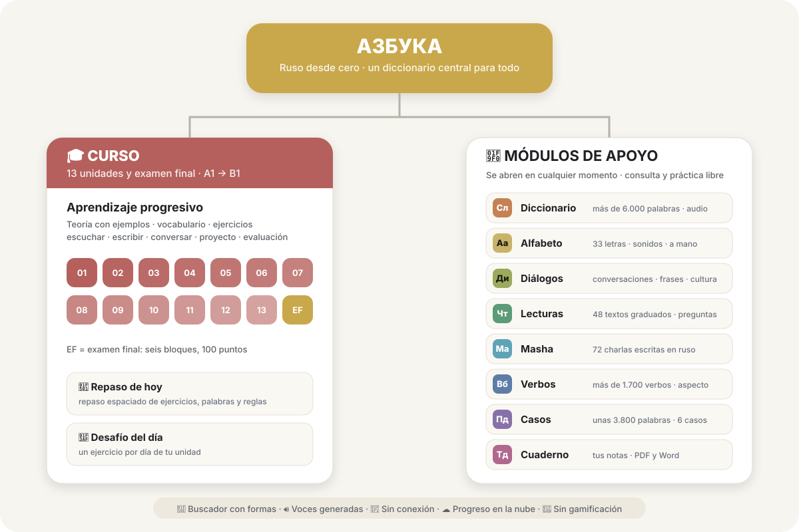

<div align="center">

# Азбука · Abecé

### Russian from zero · Испанский с нуля

[🇬🇧 English](README.md) · [🇪🇸 Español](README.es.md)

**A free web course to learn Russian from Spanish (Azbuka) and Spanish from Russian (Abecé), from zero to B1.**

[**▶ Open the app**](https://manum876.github.io/Azbuka_v3/) · [**Repository**](https://github.com/manum876/Azbuka_v3)

</div>

---

## About

**Азбука (Azbuka)** is a personal project to help Spanish speakers learn Russian from scratch up to roughly **B1 level**. The app itself is in Spanish.

It combines a **13-unit course with a final exam** and **support modules** you can open at any time: dictionary, alphabet, dialogues, readings, a chat with Masha, verbs, cases and a notebook. All vocabulary lives in a **central dictionary** that connects the course and the modules: each word is written once, and each screen shows it in its own way.

There are **no streaks, XP, lives or leaderboards**. Progress is real: what you already know, what you are learning and what is worth reviewing today.

The same app has **two directions**:

| | Azbuka | Abecé |
|---|---|---|
| For | Spanish speakers | Russian speakers |
| Language learned | Russian | Spanish from Spain |
| Language of the app and the theory | Spanish | Russian |
| Course | 13 units + final exam | 13 units + final exam |
| Scripted chat | 🙂 Masha | 🙂 Lucía |

Each direction has **its own syllabus, theory, exercises, dictionary and readings**, written from scratch for that language; what they share is the method and the app. Each learner sees one direction only, the one on their account (see [Abecé](#abecé-spanish-for-russian-speakers)).

> **Learn in order. Look up what you need. Practise what you want.**

---

## How it is organised



- **Course:** 13 progressive units, A1 to B1, plus a final exam.
- **Support modules:** reference and free practice, outside the course order.
- **Central dictionary:** the shared base.
- **Today's review:** a short daily session with what you are about to forget.

---

## The course

| Unit | Main topic |
|---|---|
| **01** | Alphabet and pronunciation |
| **02** | Introductions and basic conversations |
| **03** | Nouns, gender and numbers |
| **04** | Cases I: nominative and accusative |
| **05** | Present-tense verbs and everyday actions |
| **06** | Location, movement and the prepositional case |
| **07** | Time, dates and daily routine |
| **08** | The past and personal experiences (with verbal aspect) |
| **09** | The future and plans |
| **10** | Cases II: genitive, dative and instrumental |
| **11** | Everyday communication and real-world Russian |
| **12** | B1 grammar: pronouns, plurals, aspect, imperative and comparison |
| **13** | B1 consolidation and communication |
| **14** | Final exam: six blocks, 100 points |

Each unit has:

- **theory with explained examples**, sentences broken down word by word, typical mistakes, quick checks and "go deeper" sections;
- **vocabulary in groups**, with lists and flashcards: about 2,000 words by the end of the course;
- **an exercise bank** that adapts to how you are doing: writing, translating, listening, ordering, completing, conversing, plus types that practise the rule ("why?", "does it sound natural?", "what's wrong?"…). When something goes wrong, "📖 Review the rule" opens the explanation;
- **dialogues to record yourself**, a writing project and an assessment.

The approach is **production-oriented**: recognising the answer is not enough, you have to write it. Correction is tolerant (stress marks, е/ё and capitals don't count) and explains each mistake. From Unit 11 on, open situations are graded by intent: "✓ Correct", "💬 Understood" or "✗ Not understood".

---

## Support modules

### 📚 Dictionary

The base of the whole app: **over 6,000 words** (Comer 5000 plus Azbuka's own vocabulary). Each one has:

- the word with its **stress marked**;
- **IPA** and a **Spanish-based pronunciation guide** (jarashó, spasíba);
- part of speech and topic (food, home, travel…);
- one or more **senses**, with a Spanish translation and definition;
- gender, animacy and number for nouns; aspect and aspectual partner for verbs;
- audio, cultural notes and "Your progress" (not studied, learning, mastered).

Browse by topic and part of speech, or use the search.

### 🔤 Alphabet

The **33 letters** of the Cyrillic alphabet: print and cursive, pronunciation explained in Spanish, common mistakes, example words with audio, tracking of mastered letters and **handwriting practice** with your finger, tracing or freehand.

### 💬 Dialogues

Everyday conversations (also in a formal **вы** version), with translation, transliteration, word-by-word breakdown and a practice mode. Plus **useful phrases** learned as a whole and **cultural notes**.

### 📖 Readings

**48 graded texts**, four per unit from U2 to U13, from about 40 words at the start to about 250 at the end. Each one has audio, translation on demand and comprehension questions. Select a word you don't know to open its entry.

### 🙂 Talk with Masha

A **written chat in Russian with Masha**, the Moscow student who accompanies the course: **72 topics**, six per unit, with the vocabulary and grammar of each level. Masha remembers what you told her, answers questions about her life, suggests ideas when you don't know what to say, and offers "💬 Better" versions of what you wrote. It is not AI: the chat is scripted in advance and branches according to your answers.

### 🗣️ Verbs

Conjugations for **over 1,700 verbs**:

- present, future, past and imperative, with audio for every form;
- the **aspectual partner** side by side (imperfective / perfective), with the pair type when it is not a pure pair ("for a while", "start to", "go and come back");
- **government**: which case each verb takes, with explanation and examples.

### 📐 Cases

Declensions for **about 3,800 words**: nouns, adjectives, pronouns, determiners and numerals.

- The **6 cases** in singular and plural (or by gender for adjectives), with audio.
- Special forms: locative (в лесу́), partitive (ча́ю), counting form (два часа́), short form and comparative.
- The guide **"How cases work"**, with each case's questions, verb government and practice.

### 📝 Notebook

Your notes, organised in sections. Save any text selected in the app, a word, a phrase or a mistake from the corrector, and export to **PDF** or **Word**.

---

## Abecé: Spanish for Russian speakers

**Abecé** is the reverse direction: a course of **Spanish from Spain** for Russian speakers, with the whole app in Russian. It has its own syllabus, built around what is hard for a Russian speaker: articles, ser / estar / hay, clitic pronouns, the past tenses and written accents.

| Unit | Topic |
|---|---|
| **01** | Испанский с нуля: letters, sounds, stress and written accents |
| **02** | Кто я и кто мы: introductions, ser and tener, articles |
| **03** | Мир вокруг меня: hay / estar / ser, home and neighbourhood |
| **04** | Мой день и привычки: present tense, reflexives, gustar (+ review U1–U4) |
| **05** | Еда и покупки: shopping and ordering, lo / la |
| **06** | По городу: ir a / estar en, imperative, health |
| **07** | Общение и отношения: plans, le / les, comparisons |
| **08** | Рассказываем о прошлом: perfecto and indefinido (+ review U2–U8) |
| **09** | Истории, привычки и перемены: imperfecto |
| **10** | Планы, решения и возможности: future, conditional, si |
| **11** | Решаем проблемы: the subjunctive |
| **12** | Мнения и аргументы: combined pronouns, por / para, connectors |
| **13** | Испанский для жизни: pluperfect, reported speech |
| **14** | Финальный экзамен: six blocks, 100 points |

Its support modules are the same as Azbuka's, with their own content:

- **Словарь (Dictionary):** about **5,400 Spanish words** with IPA and a **pronunciation guide in Cyrillic** (*hola* → о́ла), meanings in Russian, gender and forms; about 1,900 are taught in the course.
- **Глаголы (Verbs):** about **1,260 verbs** conjugated in every tense, with *vosotros*.
- **Грамматика (Grammar):** takes the place of Cases: articles, pronouns, ser / estar / hay, tense usage, prepositions.
- **Алфавит и произношение, Диалоги (64 dialogues, useful phrases and cultural notes comparing Spain and Russia) and Чтение (48 readings).**
- **Болтаем с Лусией:** the mirror of Masha. A written chat in Spanish with **Lucía**, an English teacher in Barcelona: **72 topics**, six per unit. Its «💬 Лучше» corrects a Russian speaker's typical mistakes («yo es», «soy 25 años», «yo gusto», adjective gender, missing accents), and Lucía asks «¡En español, por favor!» if you write in Cyrillic.

Abecé is opened through the account: the direction is chosen when a learner is invited.

---

## Today's review

A daily session of about 10 minutes with **spaced repetition** (boxes of 1, 3, 7 and 14 days) over exercises, words and rules: what you are about to forget, from any unit, plus exercises from your current unit and "the rule of the day". Separately, the home page offers a **daily challenge** based on the unit you are in.

---

## Voices

All the Russian in the app is spoken by **neural voices generated in advance** ([Silero](https://github.com/snakers4/silero-models), model v5_5_ru), with one voice per character (Masha, Olga Petrovna, Lucas, Dima…). The audio files live in a separate repository, [`Azbuka_voces`](https://github.com/manum876/Azbuka_voces), and the phone stores them as they play. If an audio file is missing, the phone's own voice is used.

Abecé's Spanish works the same way, with audio in [`Abece_voces`](https://github.com/manum876/Abece_voces): the narration and male voices with **Silero** (es_0 to es_2), and Ana, Lucía and the female voices with **[Piper](https://github.com/rhasspy/piper)** (es_ES-sharvard).

---

## Philosophy

**1. A clear path.** The course offers an ordered progression from zero to B1, and every unit recycles what came before.

**2. Freedom of use.** The modules can be opened at any time, outside the course order.

**3. A reliable reference.** To remember how to say something, conjugate a verb or understand a case, Azbuka should be enough on its own. That's why forms are never invented: they come from cross-checked sources, reviewed by hand.

**4. Think in Russian.** Explanations use Spanish only when it helps to understand an idea, never as a model for translating.

---

## Features

- 🔁 Two directions: Russian for Spanish speakers (Azbuka) and Spanish for Russian speakers (Abecé)
- 🎓 13-unit course and final exam, A1 → B1, in each direction
- 📚 Central dictionary of over 6,000 words, with stress, IPA and pronunciation guide
- 🗣️ Over 1,700 conjugated verbs, with aspectual partner and government
- 📐 About 3,800 words declined in all 6 cases
- 📖 48 graded readings and 🙂 72 chats with Masha (and the same in Abecé, with Lucía)
- 🔁 Spaced repetition and a daily session
- 🔎 Search in Russian and Spanish that also recognises declined and conjugated forms
- 🔊 Generated voices for all the Russian in the app
- 📱 Designed for the iPhone first; installs on the home screen and works offline
- ☁️ Account with an email code and progress saved in the cloud
- 🌓 Light and dark theme
- 🚫 No gamification and no AI features: correction is rule-based

---

## Technology

- HTML, CSS and JavaScript, **no build step**.
- [Preact](https://preactjs.com/) + [htm](https://github.com/developit/htm), bundled in the repository (`assets/preact.js`).
- **Service worker** for offline use; `localStorage` for progress on the phone.
- **Accounts:** [Supabase](https://supabase.com/) (invitation-only access and cloud progress) and Brevo for the email with the code.
- **Voices:** Silero (and Piper for Abecé), generated with GitHub Actions in the `Azbuka_voces` and `Abece_voces` repositories.
- **Notebook:** jsPDF and fflate, to export to PDF and Word on the phone itself.
- Published with **GitHub Pages**.

---

## Data sources

- **Vocabulary:** Comer, K. *Comer 5000* (Portland State University) and the Russian–Spanish dictionaries from [FreeDict](https://freedict.org/) (CC BY-SA 3.0).
- **Conjugations and declensions:** data from [OpenRussian.org](https://github.com/Badestrand/russian-dictionary) (CC BY-SA 4.0).
- **Cross-checks:** the pymorphy3 morphological analyzer (OpenCorpora dictionary) and the stress indexes of Zaliznyak's Grammatical Dictionary.
- **Map:** [Natural Earth](https://www.naturalearthdata.com/) (public domain).

**Abecé (Spanish):**

- **Which words, in which order:** subtitle frequencies from OpenSubtitles 2018 (Hermit Dave's list, CC BY-SA 4.0), lemmas and categories from the Real Academia Española's **CORPES XXI** (CC BY-SA 4.0) and [wordfreq](https://github.com/rspeer/wordfreq) (CC BY-SA 4.0) for doubtful cases; levels following the Instituto Cervantes *Plan Curricular*.
- **Translations:** written for Abecé; the Spanish–Russian dictionaries from [WikDict](https://www.wikdict.com/) and FreeDict (CC BY-SA) were used only for comparison.
- **Conjugations:** generated by rules in the repository (`herramientas/abece/conjugador-es.py`) and cross-checked against Fred Jehle's *Conjugated Spanish Verb Database* and verbecc, without copying any forms.

**Original content:** definitions, explanations, exercises, dialogues, readings, the Masha and Lucía chats and notes, written for the app.

---

## Running locally

```bash
git clone https://github.com/manum876/Azbuka_v3.git
cd Azbuka_v3
python3 -m http.server
```

Then open `http://localhost:8000` in your browser. A local server is needed because the pages load data files.

---

## Repository structure

```text
Azbuka_v3/
├── index.html            ← home
├── azbuka-index-1.html   ← A1 → B1 course index
├── azbuka-1.html …       ← Azbuka units (azbuka-14.html: final exam)
├── abece-1.html …        ← Abecé units (abece-14.html: final exam)
├── ficha.html            ← dictionary and word page
├── alfabeto.html, dialogos.html, lecturas.html, masha.html, lucia.html,
│   verbos.html, casos.html, gramatica.html, cuaderno.html   ← support modules
│                            (each loads the data of the learner's direction)
├── repaso.html           ← today's review
├── ajustes.html          ← settings
├── manifest.webmanifest, manifest-abece.webmanifest  ← installed-app data
├── sw.js                 ← offline support
├── js/                   ← shared code (catalogue, menu, progress, corrector, units, accounts…)
├── data/                 ← data
│   ├── data-lexicon.js   ← central dictionary (Russian)
│   ├── data-verbos.js    ← conjugations (Russian)
│   ├── data-casos.js     ← declensions
│   ├── data-…-es.js      ← the same for Abecé (lexicon, verbs, grammar, units…)
│   └── …                 ← alphabet, dialogues, readings, Masha, Lucía, units
├── assets/               ← styles, fonts, icons and libraries
├── herramientas/         ← not used by the app: IPA generators, Masha and Lucía
│                            scripts, Spanish conjugator, voices, accounts
│                            and automated checks
├── README.md, README.es.md
└── LICENSE, LICENSE-CONTENT
```

---

## Project status

✅ **Azbuka is complete:** all 13 units, the final exam and every support module.

✅ **Abecé is complete** (November 2026): all 13 units, the final exam and its modules, including the chat with Lucía. The Russian theory is awaiting review by a native speaker.

Next: A2 and B1 dialogues, word families and, later on, the B1 → B2 and B2 → C1 levels.

---

## Contributing

Azbuka and Abecé are a personal project by **Juan Manuel Muñoz**. The repository is open to explore and learn from under its licenses, but it does not accept direct changes from third parties. If you find a bug or have a suggestion, please open an issue.

---

## License

The app uses **two licenses**, because software and educational content have different goals. They apply to both Azbuka and Abecé.

- **Code:** MIT License. See [`LICENSE`](LICENSE).
- **Educational content** (courses, exercises, definitions, explanations, dialogues, readings, the Masha and Lucía chats): **CC BY-NC-ND 4.0**. See [`LICENSE-CONTENT`](LICENSE-CONTENT).
- **Exceptions** (under **CC BY-SA 4.0**, as their original licenses require):
  - the conjugation tables (`data/data-verbos.js`) and declension tables (`data/data-casos.js`), derived from OpenRussian.org data;
  - in Abecé's lexicon (`data/data-lexicon-es.js`), the frequency, lemma and category data in the `sourceRefs` field (OpenSubtitles, CORPES XXI and wordfreq), and the CORPES source kept in `herramientas/fuentes/`.

**Third-party components**, each under its own license:

| Component | License |
|---|---|
| Preact and htm (`assets/preact.js`) | MIT and Apache 2.0 (`assets/preact-LICENSE.txt`) |
| supabase-js (`assets/supabase.js`) | MIT (`assets/supabase-LICENSE.txt`) |
| jsPDF and fflate | MIT (`assets/jspdf-LICENSE.txt`, `assets/fflate-LICENSE.txt`) |
| Noto Sans, Azbuka Script (modified Marck Script) and Azbuka Símbolos (from Noto Sans Symbols, Symbols 2 and Math) fonts | SIL Open Font License (`assets/*-OFL.txt`) |
| Natural Earth map | Public domain |
| Silero voices (`Azbuka_voces` and `Abece_voces` repositories) | CC BY-NC 4.0: non-commercial use only |
| Piper es_ES-sharvard voice (`Abece_voces` repository) | Piper and its voices: MIT; source recordings (SHARVARD, University of Edinburgh): CC BY 3.0 |

---

## Author

**Juan Manuel Muñoz**

An independent personal project to make learning Russian from Spanish —and Spanish from Russian— more structured, accessible and practical.

<div align="center">

[▶ Try the app](https://manum876.github.io/Azbuka_v3/)

</div>
